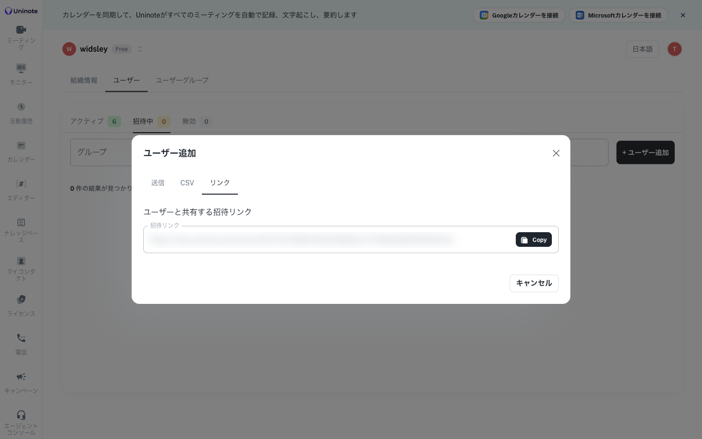
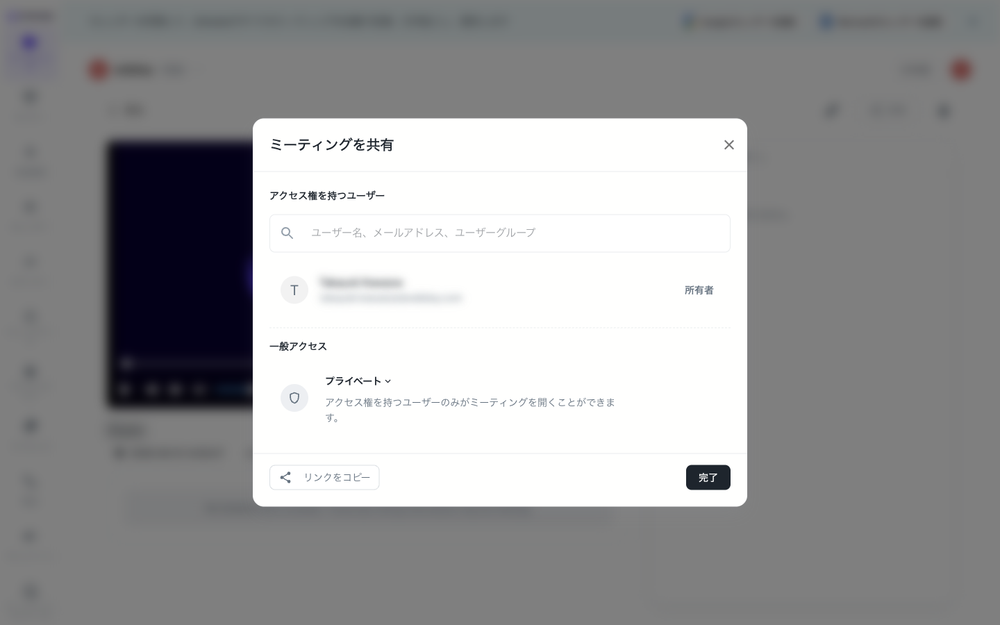
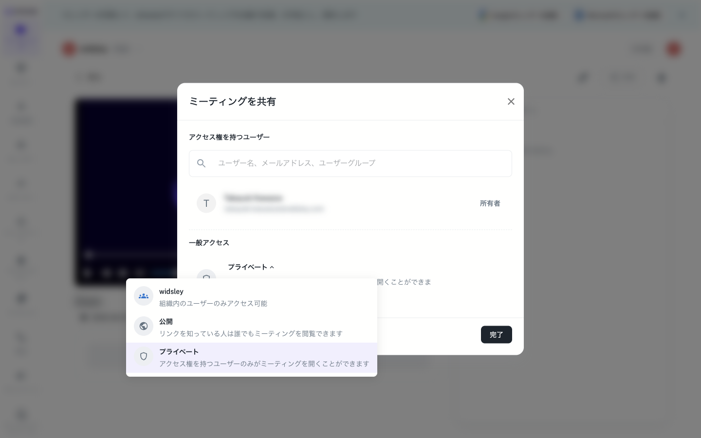

# 管理者向け

## よくあるお問い合わせ

- 招待したメンバーが参加していない、招待メールが届かない
- 招待されたメンバーが、自分で作った別の組織に入ってしまう
- 共有した会議を同僚が開けない
- カレンダーを連携したのに、ボットが会議に入らない
- メンバーがログインできない

## 原因と対処

- **「招待中」のまま**：本人がまだ一度もログインしていません。本人にログインしてもらってください。招待の有効期限は7日です。期限が切れた招待は再送できます。
- **招待メールが届かない**：迷惑メールフォルダを確認してもらってください。それでも見つからない場合は、ユーザー追加画面の「リンク」タブで招待リンクを発行し、本人に直接渡してください。
  

- **別の組織に入ってしまう**：招待されたメールアドレスと同じアドレスでログインしてもらってください。組織から外したメンバーをもう一度入れるときは、新しく招待を送ります。
- **共有した会議が開けない**：会議の公開範囲は、最初は「プライベート」です。「ミーティングを共有」で相手を追加するか、一般アクセスを「組織」に変えてください。オーナーと管理者は、組織内のすべての会議を見られます。組織外の方からアクセスリクエストが届いた場合は、承認すると閲覧できるようになります。
  
  

- **ボットが入らない**：「会議録画bot」の項目をご覧ください。

## 表示されるメッセージ

- 「この招待は無効になっています。新しい招待リンクを依頼してください。」→ 招待を送り直してください。
- 「この招待は別のメールアドレス宛に送られています。」→ 招待されたアドレスでログインし直してもらってください。
- 「このユーザーは既にこの組織のメンバーです。」
- 「このユーザーには既に保留中の招待があります。再送信してください。」→ 招待一覧から再送してください。
- 「このミーティングにアクセスする必要があります」→ 「アクセスを要請」を押すか、権限のあるアカウントに切り替えてください。
- 「メールアドレスまたはパスワードが正しくありません。Google・Microsoft で登録された方は、下のボタンからログインしてください。」→ 登録したときと同じ方法でログインしてもらってください。
- 「Googleカレンダーの接続を開始できませんでした。もう一度お試しください。」→ 連携をやり直してください。

## 必要な環境

- **Google カレンダー連携**：カレンダーへのアクセスを許可する必要があります。
- **Microsoft（Outlook）カレンダー連携**：予定表の読み取りを許可する必要があります。会社の設定によっては、IT管理者の承認が要ることがあります。

## 制限事項

- 多要素認証とIPアドレス制限には対応していません。
- 組織ごとにログイン方法（メール／Google／Microsoft）を限定する設定はありません。
- パスワードは8文字以上で、数字を1文字以上含める必要があります。
- Google でログインしたアカウントと、同じ Gmail アドレスでパスワード登録したアカウントは、別のアカウントとして扱われます。

## お問い合わせのときにお送りいただきたい情報

- 組織名
- 対象メンバーのメールアドレス
- 発生日時
- 画面に出たメッセージ（スクリーンショット）

# 会議録画bot

Google Meet・Microsoft Teams・Zoom の会議にボットが参加し、録画と文字起こしをします。「ボットが入らない」というお問い合わせの多くは、会議の入室リクエストに誰も応答しなかったケースです。

## よくあるお問い合わせ

- ボットが会議に入ってこない
- 先に入室したのに、ボットが来ない
- 遅れて入室したら、ボットがもう退出していた
- 直前に作った予定や、開始後に変えた予定にボットが来ない
- 同じ会議が2件表示される

## 原因と対処

- **入室が承認されていない**：ボットは「（組織名）'s Notetaker」という名前で入室をリクエストします。Google Meet では、約10分誰も応答しないと自動で打ち切られます。承認の通知が出るのは主催者と招待済みの参加者だけなので、主催者の画面で承認してください。
- **ボットが来る時刻**：ボットは予定開始の約3分前に起動し、1〜2分前に入室をリクエストします。早く入室しても、ボットが早く来ることはありません。
- **ボットを呼び直したい**：ミーティング画面の「新しいミーティング」に会議URLを貼ると、ボットを呼べます。

- **直前・開始後に変えた予定**：開始時刻を過ぎてから反映された予定には、ボットは自動で参加しません。直前に作った予定は、「新しいミーティング」から手動で呼ぶのが確実です。
- **ほかの参加者が全員退出した**：ボットは約60秒で自動的に退出します。
- **会議が2件ある**：デスクトップアプリとボットの両方で録画すると、2件になります。不要な方を削除してください。
- **ストレージの上限、お支払い状況**：どちらかに当てはまると、ボットは参加しません。

## 表示されるメッセージ

- 「Botが入室できませんでした」：承認されなかった会議、または誰もいなかった会議です。通常の一覧には出ません。期間の絞り込みの横にある「未入室会議を表示」で確認できます。

- 「ボットは既にこのミーティングに割り当てられています。」：同じ組織の誰かのボットが、すでに入っています。録画はその会議にまとめられ、あなたも参加者として追加されます。
- 「このミーティングURLは既に別の組織のボットによって記録されています。」：別の組織のボットが先に記録しています。この場合、あなたの組織には記録が作られません。
- 「このミーティングではボットがまだ稼働中のため、新しいボットは起動されませんでした。現在のボットが退出した後にもう一度お試しください。」
- 「ボットの起動に失敗しました。もう一度お試しください。」→ 少し時間をおいて、もう一度試してください。
- 「有効なミーティングURL（Google Meet、Zoom、またはMicrosoft Teams）を入力してください。」
- 「お支払い状況のため、ボットの参加をスキップしました。」→ お支払い状況を確認してください。
- 「ストレージ上限に達しました」→ 空き容量を作るか、プランを変更してください。

## 利用条件

- **対応している会議**：Google Meet、Microsoft Teams、Zoom
- **自動で参加させるには**：Google カレンダーか Microsoft（Outlook）カレンダーを連携し、予定に会議URLが入っている必要があります。連携していなくても、手動で呼べば録画できます。
- **Zoom**：社外のアカウントが主催する Zoom 会議に参加させるには、Zoom 連携が必要です。
- ボットはクラウド上で動くため、お手元のPCや回線の状態には影響されません。

## 制限事項

- Google Meet で入室を待てる時間は、Meet 側の仕様で約10分です。延ばすことはできません。
- Teams では、ボットはゲストとして参加します。主催者側で承認が必要です。Teams のライブイベント（ウェビナー）には対応していません。
- 録画は映像と音声の両方を保存します。音声だけを保存する設定はありません。
- 入室できなかった会議が履歴に残るのは、2026年9月17日以降の分です。

## お問い合わせのときにお送りいただきたい情報

会議の日時と会議URL、予定を入れた方のメールアドレス、主催者の画面に入室リクエストが届いていたか、画面に出たメッセージ（スクリーンショット）

# デスクトップアプリ（Uninote Recording）

## よくあるお問い合わせ

- Mac で録画を開始できない、画面やウィンドウの一覧が出ない
- 録画がアップロードされない
- 録画中にアプリが終了してしまう
- 会議を始めても「録画しますか」が出ない
- 録画の映像が真っ黒になる

## 原因と対処

- **Mac で録画できない**：画面収録の許可が必要です。システム設定 → プライバシーとセキュリティで、「画面収録」「マイク」「アクセシビリティ」の「Uninote Recording」をオンにしてください。そのあと、アプリを完全に終了して開き直してください。オンなのに直らないときは、一覧から「−」で一度削除し、もう一度許可してください。
- **アップロードされない**：録画一覧の上に「アップロード待ちの録画」が出ていたら、「アップロード」を押してください。デスクトップアプリは、失敗した録画を自動では送り直しません。アプリが途中で終了した場合も、次に起動したときにこの一覧に出ます。
- **映像が真っ黒**：ウィンドウを選んで録画している場合、そのウィンドウを最小化すると映像が止まります。録画の対象は「全画面」を選んでください。
- **録画を止めたのに、また始まってしまう**：最新版に更新してください。設定の「自動的に録画を開始」をオフにしても防げます。

## 表示されるメッセージ

- 「画面収録の許可が必要です。システム設定 → プライバシーとセキュリティ → 画面収録 で有効にしてから、アプリを再起動してください。」
- 「サインアウトされています。もう一度サインインするとアップロードできます。録画データはこのままローカルに保存されています。」→ 「サインインし直す」を押してください。
- 「（エラー内容） — 録画はローカルに保存されており、録画一覧画面から再アップロードできます。」→ 録画一覧からアップロードしてください。
- 「この録画は（サイズ）MBあり、アップロード上限の（上限）MBを超えています。」
- 「最大録画時間（3時間）に達しました — 録画を停止してアップロード中」
- 「前回の録画をまだアップロード中です。」→ アップロードが終わるまでお待ちください。
- 「録音を開始できませんでした：組織のストレージが上限に達しています。」／「組織に未払いの請求があります。」→ 組織の管理者にご連絡ください。
- 「このプラットフォームではシステム音声のキャプチャを利用できません。マイクのみが録音されます。」→ 相手の声はスピーカーで再生してください。
- 「ダウンロードフォルダ等から起動しているため自動更新できません。」→ アプリをアプリケーションフォルダへ移動してください。

## 動作環境

- macOS 13 以降（Apple シリコン版と Intel 版があります）
- Windows 10 以降（64bit）
- Mac では、マイク・画面収録・アクセシビリティ・オートメーションの許可が必要です。
- 録画データはパソコンに保存されます。Mac は「ムービー」フォルダの UninoteRecordings、Windows は AppData 内の Recordings です。保存先は設定の「出力フォルダ」で変えられます。
- ダウンロード：[https://recording-updates.uninote.ai/](https://recording-updates.uninote.ai/)

## 制限事項

- Windows では、インストールのときに警告が出ることがあります。「詳細情報」→「実行」を押すと進めます。
- アップデートは自動でダウンロードされ、「再起動してアップデート」を押すか、アプリを終了したときに反映されます。
- Chrome のタブ単位では録画できません。ウィンドウか全画面を選んでください。
- 録画できる長さは最大3時間です。

## お問い合わせのときにお送りいただきたい情報

- アプリのバージョン（設定画面に「バージョン 0.1.646」のように表示されます）
- OS とそのバージョン（Mac の場合は Apple シリコンか Intel か）
- 発生日時
- 会議ツール（Meet・Zoom・Teams など）
- 画面のスクリーンショット
  - アプリの動作記録は自動で弊社に届くため、ログを取っていただく必要はありません。

# モバイルアプリ（Uninote F2F）

## よくあるお問い合わせ

- 録音が Web に届かない、自動で送信されない
- 録音の途中から音が入っていない、こもっている
- 録音を始めたときに、空の会議が残る
- ログインできない

## 原因と対処

- **録音が届かない**：通信が不安定だったか、送信中にアプリを閉じたり別の画面に切り替えたりした可能性があります。録音は端末に残っています。アプリを開くと、送信が自動で再開されます。それでも残っている場合は、「保留中のアップロード」で「アップロードを再試行」を押してください。Wi-Fi などの安定した回線で、送信が終わるまでアプリを開いたままにしてください。
- **アプリを強制終了してしまった**：録音は端末に残っています。次に起動したときに、自動で送信されます。
- **音が入っていない**：録音中は端末を机の上に置き、マイクをふさがないでください。ポケットや鞄に入れたままだと、音がこもったり入らなかったりします。
- **ログインできない**：Google・Microsoft・Apple で登録した方は、画面下のボタンからログインしてください。
- 不具合があるときは、まずアプリを最新版に更新してください。

## 表示されるメッセージ

- 「インターネットに接続していません。オンラインになると（件数）件の録音がアップロードされます。」→ 録音は消えていません。オンラインに戻れば送信されます。
- 「録音は安全に保存されています。オンラインに戻ると自動的にアップロードされます。」
- 「この録音ではライブ文字起こしはオフラインです。」→ 通信がないため、リアルタイムの文字起こしが止まっています。録音は続いています。
- 「（組織名）で録音されました。この組織に切り替えるとアップロードされます。」→ 録音したときの組織に切り替えてください。
- 「マイクは通話または他のアプリが使用中です。空き次第、録音は自動的に再開されます」→ 通話などが終われば、録音は自動で再開します。
- 「マイクへのアクセスが必要です」→ 端末の設定で、マイクを許可してください。
- 「録音はこの端末に安全に保存されています。組織の未払いの請求が解決されると自動的にアップロードされます。」→ 組織の管理者にご連絡ください。
- 「ストレージ上限に達しました」→ 組織のストレージがいっぱいです。オーナーか管理者に、空き容量の確保かプランの変更を依頼してください。
- 「このバージョンのUninoteはサポートが終了しました。」→ アプリを更新してください。

## 動作環境

- iOS 15.0 以降
- Android 7.0 以降
- マイクの許可が必要です。通知の許可は任意で、アップロードの完了や要約ができたときにお知らせします。
- 録音は通信がなくてもできます。リアルタイムの文字起こしと録音の送信には、通信が必要です。
- 別のアプリに切り替えても、録音は続きます。iPhone では、別のアプリを開いてしばらくすると送信が止まりますが、アプリに戻ると再開します。

## 制限事項

- オフラインのときと一時停止中は、リアルタイムの文字起こしが止まります。
- 録音中の音声を、ほかの人がリアルタイムで聞く機能はありません。
- 多要素認証には対応していません。

## お問い合わせのときにお送りいただきたい情報

アプリのバージョン（設定画面の下に「Uninote v1.1.x」と表示されます）、端末の機種と OS のバージョン、発生日時と会議名、画面のスクリーンショット（「保留中のアップロード」の画面も）。アプリの動作記録は自動で弊社に届くため、ログを取っていただく必要はありません。
