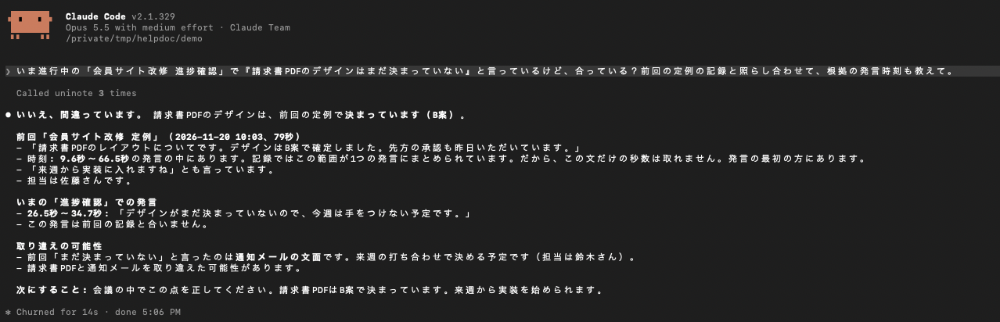
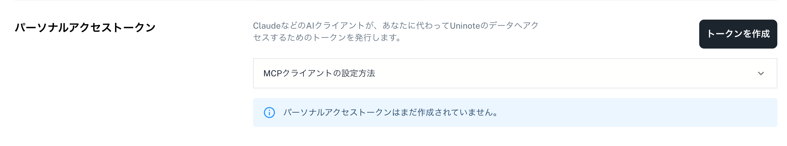
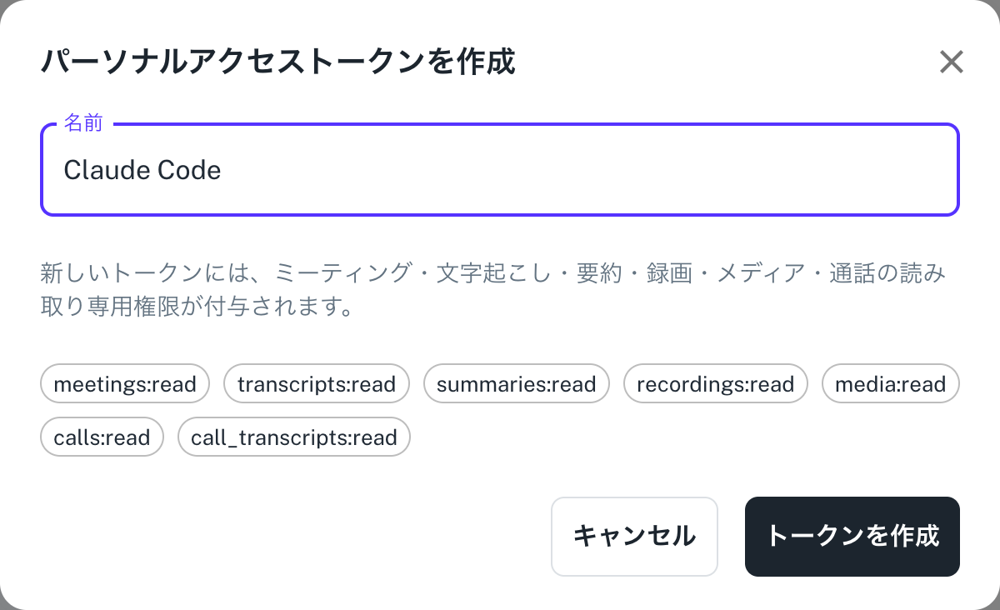
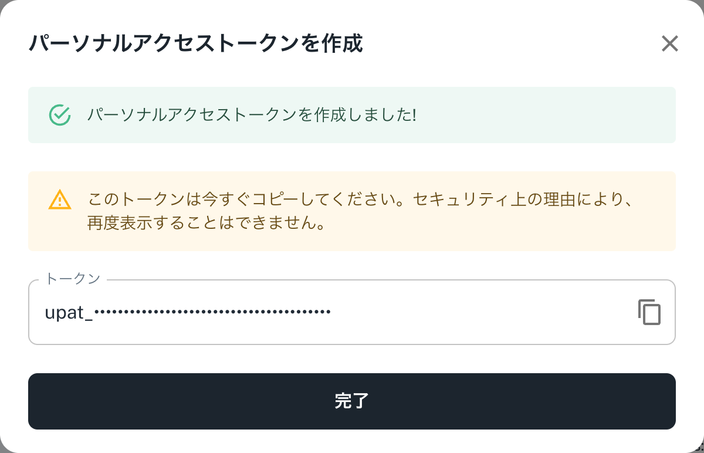
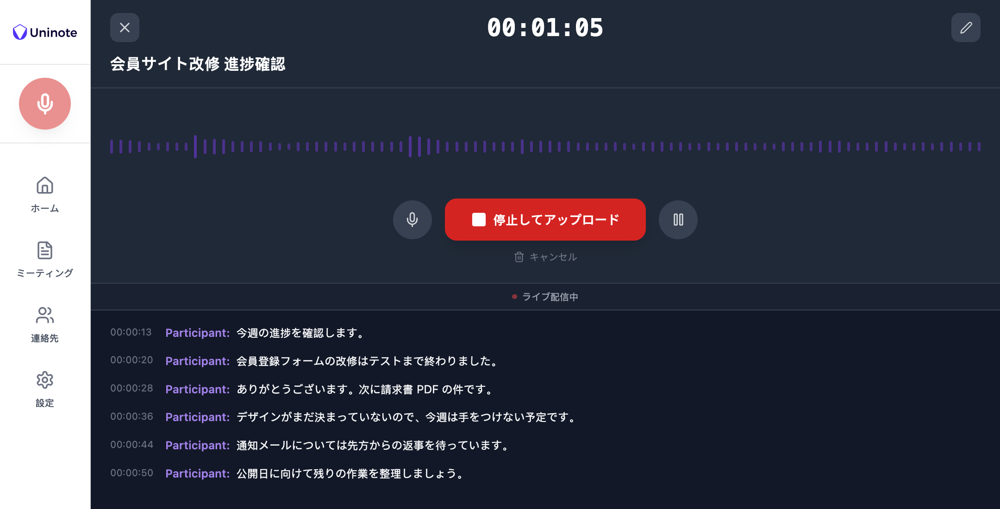
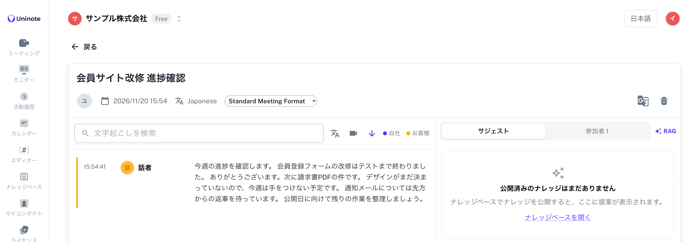

<Info>
  You can ask Claude Code (Anthropic's AI assistant) questions while Uninote records a meeting. Claude reads the transcript of the meeting in progress and the record of past meetings. It answers with the time of the remarks it used as evidence.
</Info>

### What you can do

In meetings, people often disagree about the facts: "That was decided last week" or "I think that is not decided yet". Often, nobody checks the record until the meeting is over.

With this setup, Claude checks the record during the meeting. You can find a mistake and correct it before the meeting ends.

<Frame>
  
</Frame>

---

### What you need

- **A Uninote account**: you are a member of an organization that can record meetings.
- **A way to record the meeting**: when you record with one of these, the transcript is saved while the meeting is in progress.
  - Desktop app (Uninote Recording)
  - Mobile app
  - Recording bot (Google Meet, Microsoft Teams)
- **Claude Code**: an AI assistant from Anthropic. To install it and sign up, follow Anthropic's guide.<br />[https://code.claude.com/docs/en/overview](https://code.claude.com/docs/en/overview)
- **A personal access token**: the key that lets Claude read your Uninote data. Issue it with the steps below.

<Warning>
  When you ask Claude a question, the meeting content it needs to answer (transcripts, summaries and so on) is sent to Anthropic. Check your company's rules for AI use before you start.
</Warning>

---

### 1. Issue a personal access token

1. Click the icon at the top right of Uninote and open **My account**.
2. In the **Personal Access Tokens** section, click **Create token**.
3. In **Name**, enter a name that shows what the token is for (for example: Claude Code).
4. Click **Create token**.
5. Copy the token that is shown.

<Frame>
  
</Frame>

<Frame>
  
</Frame>

<Frame>
  
</Frame>

<Warning>
  The token is shown only once, when you create it. You cannot see it again later. Do not share it with anyone.
</Warning>

<Info>
  The token can only read data. Claude cannot edit or delete your meetings. It can read only the meetings and calls that you can see in Uninote.
</Info>

### 2. Add Uninote to Claude Code

Run this command in your terminal. Replace `<your token>` with the token you copied in step 1.

```bash
claude mcp add --transport http uninote https://prod-api.uninote.ai/mcp --scope user --header "Authorization: Bearer <your token>"
```

You can also copy this command from **How to set up an MCP client** in the **Personal Access Tokens** section.

### 3. Check the connection

1. Restart Claude Code.
2. Type `/mcp`.
3. Make sure that `uninote` is in the list and shows as connected.

---

### How to use it during a meeting

1. Start recording the meeting in Uninote as usual.

   <Frame>
     
   </Frame>

2. When you hear a remark you want to check, ask Claude Code. Tell it the meeting name and which remark you want to check.
3. Claude reads the transcript of the meeting in progress and the record of past meetings, then answers. The answer includes the meeting and the time of the remarks it used as evidence.
4. Check the evidence at those times in Uninote. You can also see the transcript of a meeting in progress on the **Monitor** screen.

   <Frame>
     
   </Frame>

<Info>
  When you ask about the meeting in progress, tell Claude to read the newest part, for example "the last part of the current meeting" or "what we just talked about".
</Info>

### Example questions

- "Someone just said the invoice PDF design is not decided yet. Is that correct?"
- "Who took this task in the last regular meeting?"
- "What release date did we decide in last month's meeting?"
- "List what is still undecided in the current meeting."
- "Is there anything in what was just said that conflicts with last week's decisions?"
- "Summarize the action items from this meeting by owner."

---

### Tips

- **Give the meeting name**: names such as "weekly meeting" or "meeting with Company X" help Claude find the meeting.
- **Give a period**: "from the meetings in the last month" narrows the search.
- **Check the evidence**: Claude's answer is a summary based on the record. Before an important decision, check the remarks at the given times in Uninote.

### FAQ

**The answer does not include the meeting in progress.**<br />
The transcript is saved a short time after each remark. Wait a moment, then ask again.

**I want to disable a token.**<br />
In the **Personal Access Tokens** list, click **Revoke** for the token. Claude stops reading your Uninote data with that token immediately.

**Can Claude read meetings in another organization?**<br />
A token belongs to the user and the organization that issued it. To read meetings in another organization, switch to that organization and issue a token there.

**What happens when the person who issued the token leaves the organization?**<br />
The token for that organization stops working. Claude can no longer read that organization's meetings.

### Related pages

- [Monitor](/en/monit)
