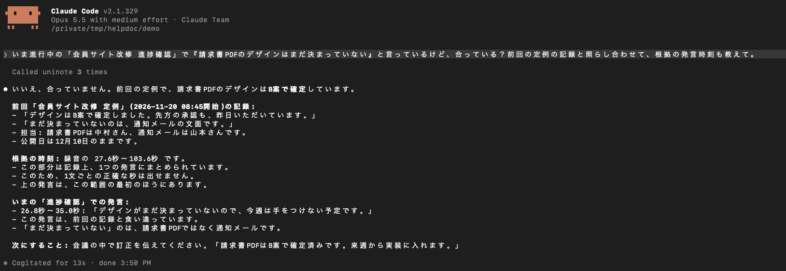
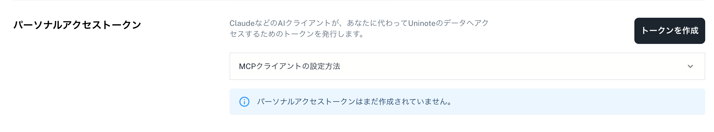
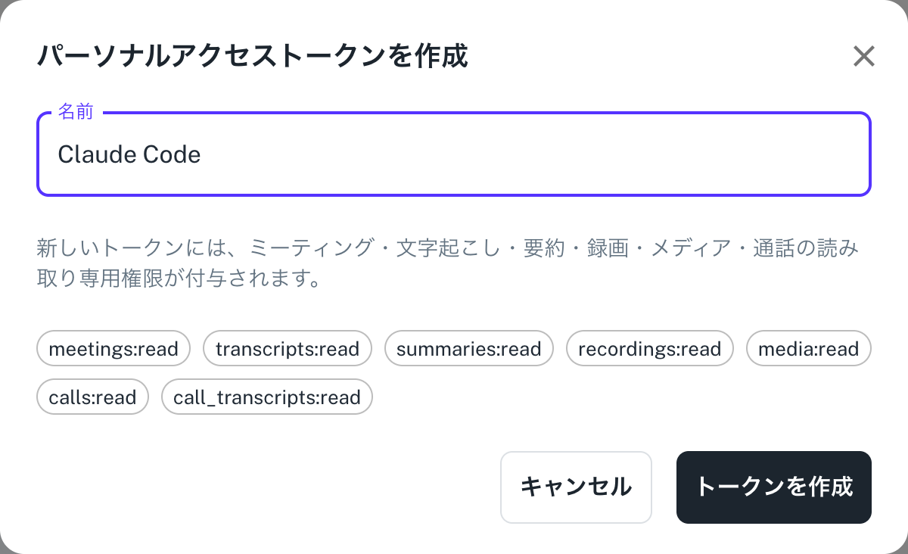
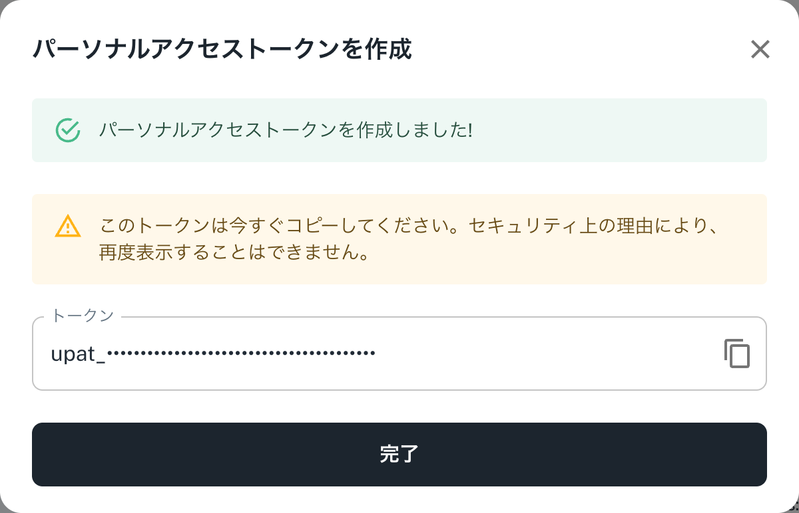
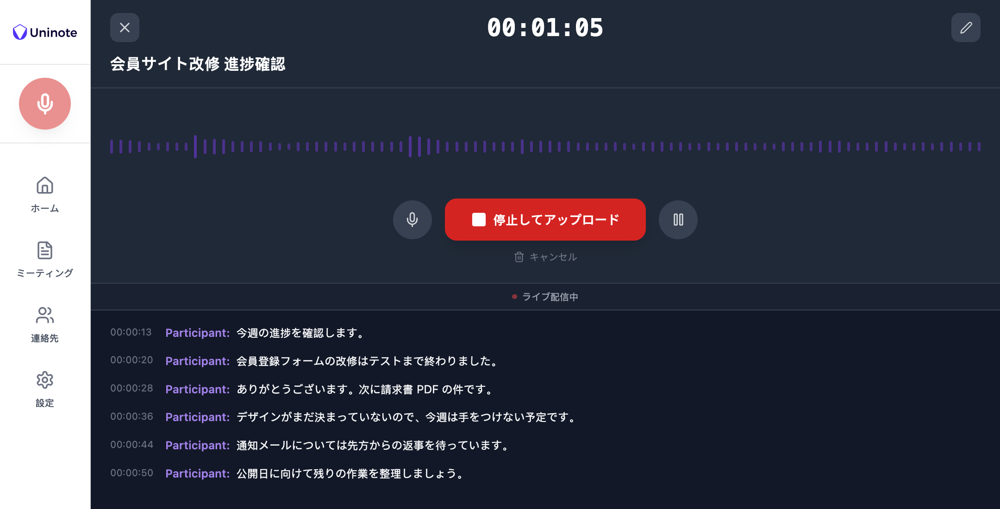
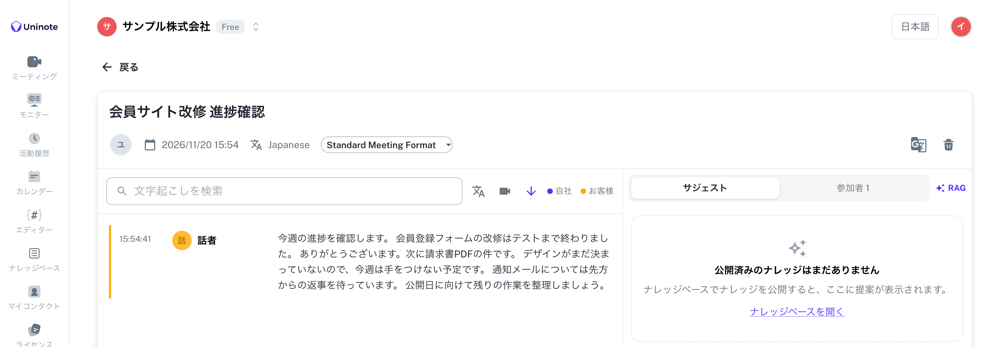

<Info>
  Uninoteで会議を録音しながら、Claude Code（AnthropicのAIアシスタント）に質問できます。Claudeは、進行中の会議の文字起こしと過去の会議の記録を読み、根拠となる発言の時刻を添えて答えます。
</Info>

### この使い方でできること

会議では、「それは先週決まったはず」「まだ決まっていないと思う」といった食い違いがよく起こります。記録を確かめるのは会議が終わってから、ということも多いはずです。

この使い方では、会議の最中にClaudeが記録を確かめます。会議が終わる前に思い違いに気づき、その場で訂正できます。

<Frame>
  
</Frame>

---

### 必要なもの

- **Uninoteのアカウント**：会議を録音できる組織に参加していること。
- **会議の録音手段**：次のいずれかで録音した会議は、録音中に文字起こしが保存されます。
  - デスクトップアプリ（Uninote Recording）
  - モバイルアプリ
  - Chrome拡張機能
  - 録画Bot（Google Meet・Microsoft Teams）
- **Claude Code**：Anthropicが提供するAIアシスタントです。インストールと契約は、Anthropicの案内に従ってください。<br />[https://code.claude.com/docs/ja/overview](https://code.claude.com/docs/ja/overview)
- **パーソナルアクセストークン**：ClaudeがUninoteのデータを読むための鍵です。下の手順で発行します。

<Warning>
  Claudeに質問すると、回答に必要な会議の内容（文字起こし・要約など）がAnthropicに送られます。社内のAI利用ルールを確認してから使ってください。
</Warning>

---

### 1. パーソナルアクセストークンを発行する

1. Uninoteの画面右上のアイコンを押し、［マイアカウント］を開きます。
2. ［パーソナルアクセストークン］の欄で、［トークンを作成］を押します。
3. ［名前］に、用途がわかる名前を入力します（例：Claude Code）。
4. ［トークンを作成］を押します。
5. 表示されたトークンをコピーします。

<Frame>
  
</Frame>

<Frame>
  
</Frame>

<Frame>
  
</Frame>

<Warning>
  トークンは作成したときに一度だけ表示されます。あとから見ることはできません。他の人に共有しないでください。
</Warning>

<Info>
  トークンでできるのは読み取りだけです。Claudeが会議を編集したり、削除したりすることはできません。読み取れるのは、あなたがUninoteで閲覧できる会議と通話に限られます。
</Info>

### 2. Claude CodeにUninoteを登録する

ターミナルで次のコマンドを実行します。`<あなたのトークン>` の部分を、手順1でコピーしたトークンに置き換えてください。

```bash
claude mcp add --transport http uninote https://prod-api.uninote.ai/mcp --scope user --header "Authorization: Bearer <あなたのトークン>"
```

このコマンドは、［パーソナルアクセストークン］の欄の［MCPクライアントの設定方法］からもコピーできます。

### 3. 接続を確認する

1. Claude Codeを起動し直します。
2. `/mcp` と入力します。
3. 一覧に `uninote` が表示され、接続済みになっていることを確認します。

---

### 会議中の使い方

1. いつもどおり、Uninoteで会議の録音を始めます。

   <Frame>
     
   </Frame>

2. 会議の途中で気になる発言があったら、Claude Codeに質問します。会議名と、どの発言を確かめたいかを伝えてください。
3. Claudeは、進行中の会議の文字起こしと、過去の会議の記録を読んで答えます。回答には、根拠となった会議と発言の時刻が付きます。
4. 根拠の時刻を、Uninoteの画面で確かめます。進行中の会議の文字起こしは、Uninoteの［モニター］画面でも見られます。

   <Frame>
     
   </Frame>

<Info>
  進行中の会議について聞くときは、「いまの会議の最後の部分」「直前に話していた内容」のように、会議の新しい部分を読むように伝えてください。
</Info>

### 質問の例

- 「いま『請求書PDFのデザインは未確定』と言っているけど、合っている？」
- 「この件、前回の定例では誰が担当になった？」
- 「先月の会議で、公開日はいつと決めた？」
- 「いまの会議で、まだ決まっていないことを一覧にして」
- 「さっきの発言と、先週の決定事項で食い違っているところはある？」
- 「この会議で出た宿題を、担当者ごとにまとめて」

---

### うまく使うコツ

- **会議名を伝える**：「週次定例」「〇〇社との打ち合わせ」のように伝えると、Claudeが会議を探しやすくなります。
- **期間を伝える**：「過去1か月の会議から」のように伝えると、探す範囲を絞れます。
- **根拠を確かめる**：Claudeの回答は、記録をもとにした要約です。大事な判断の前には、根拠の時刻の発言をUninoteで確かめてください。

### よくある質問

**進行中の会議の内容が回答に入っていません。**<br />
文字起こしは、発言から少し遅れて保存されます。少し待ってから、もう一度質問してください。

**トークンを無効にしたいです。**<br />
［パーソナルアクセストークン］の一覧で、対象のトークンの［無効化］を押します。無効にしたトークンを使っているClaudeは、すぐにUninoteのデータを読めなくなります。

**別の組織の会議も読めますか。**<br />
トークンは、発行したユーザーと組織に紐づきます。別の組織の会議を読む場合は、その組織に切り替えてからトークンを発行してください。

### 関連ページ

- [モニター](/ja/monit)
